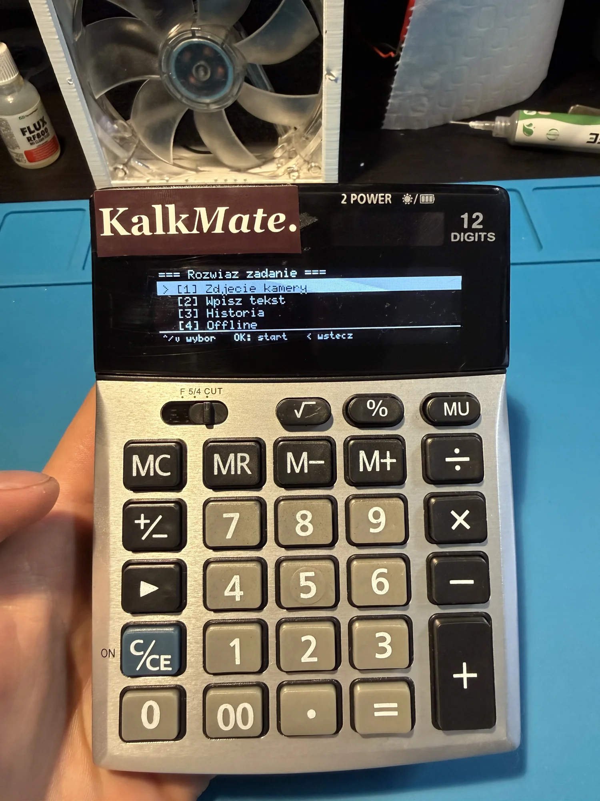
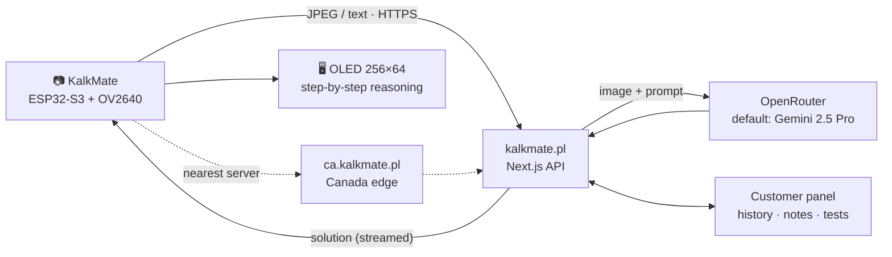
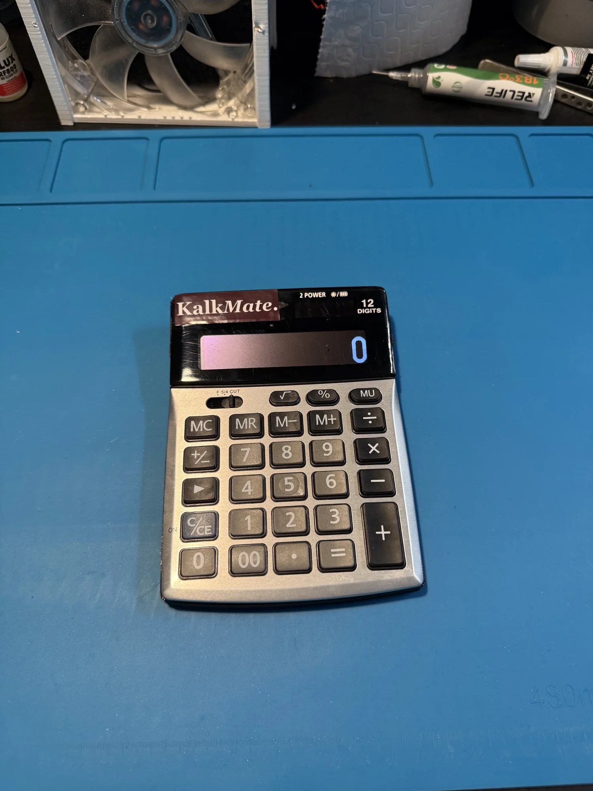
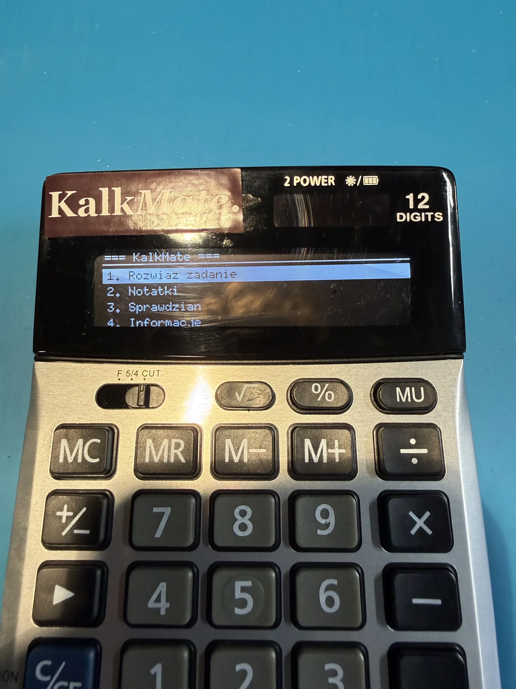
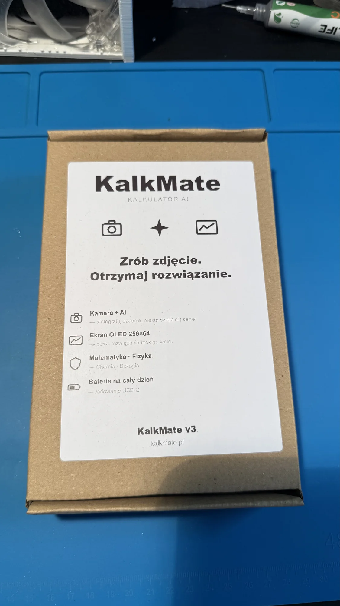
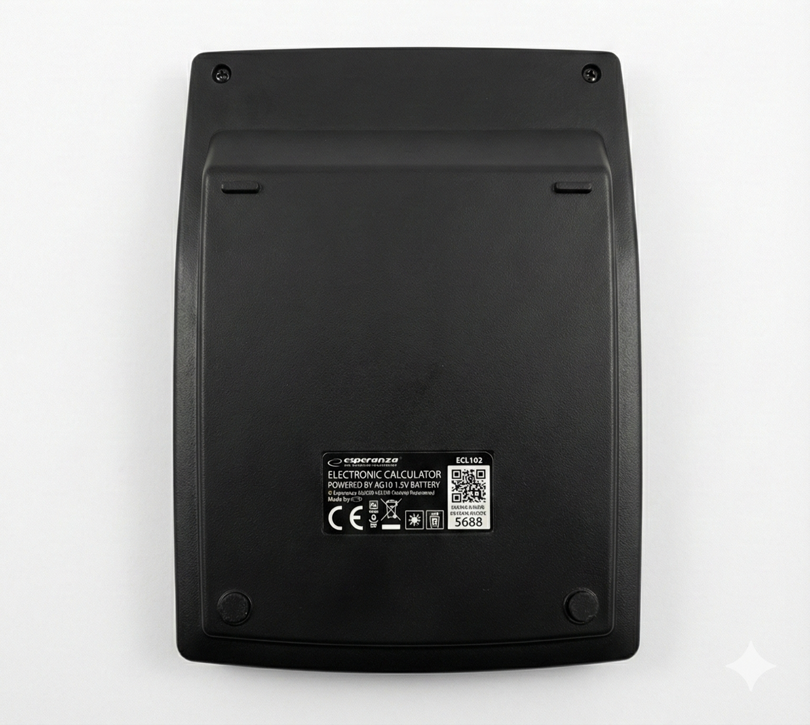

<p align="center">
  
</p>

<h3 align="center">A calculator with a camera and AI for learning</h3>

<p align="center">
  Take a photo of a problem — a step-by-step solution appears on the calculator's screen.<br>
  No phone, no browser, no distractions.
</p>

<p align="center">
  <a href="https://kalkmate.pl/en"></a>
  
  
  
  
</p>

<p align="center">
  <a href="README.md">Polski</a> · <b>English</b>
</p>

<p align="center">
  
</p>

---

## At a glance

- **Photo or text → solution.** Built-in OV2640 camera, full reasoning on a 256×64 OLED — long solutions too (up to ~96 KB of text, fast scrolling by holding an arrow key).
- **Maths, physics, chemistry, biology** — „Egzamin” (Exam) mode based on CKE exam papers and marking rules, „Czysty AI” (Plain AI) mode for everything else, or a **custom system prompt** set in the panel.
- **Still useful offline** — simple problems (equations, systems, percentages, derivatives) are solved locally; the rest is queued for sending.
- **Notes and tests** synced from the customer panel on kalkmate.pl.
- **12 UI languages** (PL, EN, DE, CS, SK, LT, BE, ES, PT, FR, IT, KO); the screen also shows Greek, Cyrillic, Korean Hangul and maths symbols (≠ ≤ ≥ ≈ √ ∞).
- **Over-the-air updates** — signed OTA (ECDSA P-256), update campaigns from the admin panel.
- **AI mode protected by a code** set by the owner; emergency factory reset by holding C/CE.

> 699 zł / 169 EUR with 2 million AI tokens included, 2-year warranty. Shipping to InPost Paczkomat lockers in Poland and by courier abroad. You can also **rent** one for a week, a month or 2 months ([kalkmate.pl/wypozyczenie](https://kalkmate.pl/wypozyczenie)).

## How it works



1. The student picks **Camera photo** (live viewfinder with a focus bar) or **Type text**.
2. The camera is powered down **before** WiFi starts — the camera clock interferes with 2.4 GHz.
3. The calculator picks the nearest server (Milan or the Canada edge) and sends the problem. It authenticates with a per-device token.
4. The backend sends the problem via **OpenRouter**. The default model is Gemini 2.5 Pro; another one can be picked in the panel (Claude, GPT, Grok, DeepSeek, Qwen…). Usage is billed in tokens; a single answer can be up to 18k tokens.
5. Long answers are sent with keepalive (the server holds the connection open until the model finishes), and the calculator writes them to PSRAM in chunks. LaTeX formulas are converted into readable text and symbols, and the answer is saved to history.

## Gallery

<table>
<tr>
<td width="50%" align="center">
<br>
<sub>A finished unit</sub>
</td>
<td width="50%" align="center">
<br>
<sub>AI mode menu: problems, notes, tests</sub>
</td>
</tr>
<tr>
<td width="50%" align="center">
<br>
<sub>KalkMate v3 packaging</sub>
</td>
<td width="50%" align="center">
<br>
<sub>Camera integrated into the back of the case</sub>
</td>
</tr>
</table>

Promo video (34 s, with voice-over): [`marketing/promo-video/`](marketing/promo-video/).

## Repository

| Directory | Contents |
|---|---|
| [`src/`](src/), [`include/`](include/) | ESP32-S3 firmware (C++ / Arduino, PlatformIO) |
| [`website/`](website/) | Shop, rentals, customer panel, admin panel and device API (Next.js) — [README](website/README.md) |
| [`fiscal-agent/`](fiscal-agent/) | Fiscal agent (Python): receipts from the platform printed on a POSNET printer over TCP/WiFi — [fiscalisation](docs/fiskalizacja/README.md) |
| [`tools/flasher/`](tools/flasher/) | Production flasher (GUI + CLI): firmware, Flash Encryption, AI code and customer language, Niimbot labels, shipping checklist |
| [`tools/kalkmate-admin-desktop/`](tools/kalkmate-admin-desktop/) | Admin panel as a Windows app (Electron): flasher, silent label printing, built-in fiscal agent |
| [`tools/edge/`](tools/edge/) | nginx edge configuration (ca.kalkmate.pl) |
| [`tools/i18n/`](tools/i18n/) | Firmware UI translation generator |
| `tools/i2c_scan`, `keymap_scan`, `greek_font_test` | Board bring-up and display test tools |
| `tools/etykieta-produktowa/` | 100×150 mm product label with compliance marks |
| [`certyfikacja/`](certyfikacja/) | BOM, component certificates, CE declaration of conformity |
| [`docs/`](docs/) | v4 user manuals in 11 languages (HTML + PDF), complaint forms, security audit, enclosure model |
| [`marketing/`](marketing/) | Promo video and its sources |

## Hardware (board v4)

| | |
|---|---|
| **MCU** | ESP32-S3-WROOM-1-N16R8 (16 MB QIO flash, 8 MB OPI PSRAM), native USB-C (USB-CDC) |
| **Display** | SSD1322 OLED 256×64, 4-wire SPI, 12 V supply from an MT3608 boost (EN on GPIO47) |
| **Camera** | OV2640, 8-bit parallel + SCCB, 2.8 V / 1.3 V LDOs; PWDN and RESET via the MCP23017 |
| **Keypad** | Calculator membrane: 10 FFC traces, 27 keys, pair scanning via an MCP23017 I2C expander |
| **Power** | 3.7 V 1500 mAh LiPo, MCP73831 charger, DW01A + FS8205A protection, MAX17048 fuel gauge (older units: ADC divider, detected automatically) |
| **Compliance** | CE declaration (RED / RoHS / LVD); radio module carries the manufacturer's RED certificate |

Peripherals are switched off when not needed: OLED boost (~140 mA), camera (~50 mA), WiFi (~80 mA, with radio sleep mode).
Full pinout, startup sequences and hardware pitfalls: [`CLAUDE.md`](CLAUDE.md). Older v3 boards (ESP32-WROVER-E) are no longer supported.

## Firmware

```bash
pio run -e esp32s3 -t upload   # only environment: board v4 (ESP32-S3)
pio device monitor -b 115200
```

> Bump `FW_VERSION` in `src/main.cpp` before every release — OTA compares versions. OTA release: build → signature (`sign_firmware.sh`) → version in the server env → `releases.json`.

| Module | Purpose |
|---|---|
| `main.cpp` | startup, main loop, menus |
| `calculator.h`, `factory_reset.h` | calculator mode, code-gated entry to AI mode, factory reset (hold C/CE for 5 s, or via Settings) |
| `solve_screen.h`, `camera.h` | live viewfinder, capture, AI request, receiving long answers into PSRAM, rendering with font fallback |
| `offline_solver.h`, `offline_queue.h` | offline solving and the queue of requests to send |
| `notes.h`, `tests.h`, `history.h` | notes, tests, history |
| `device_account.h`, `account_screen.h` | device registration, account pairing, license status, Device ID + QR code |
| `server_select.h` | nearest server selection (Milan / Canada) |
| `ota_update.h`, `kalkmate_certs.h` | signed OTA, server TLS certificate verification |
| `remote_session.h` | „Zdalna pomoc” (Remote help) — screen view for support, only after the user explicitly turns it on |
| `event_log.h` | log of important events (errors, resets) sent on registration |
| `wifi_settings.h`, `wifi_persist.h`, `settings_screen.h` | WiFi, settings, language |
| `i18n_extra.h`, `kalk_translit.h`, `ui_kit.h` | UI translations, transliteration, shared UI elements |
| `battery.h`, `power.h`, `input.h`, `panic.h` | battery and power saving, keypad, return to the calculator screen |

### Version history

| Version | Highlights |
|---|---|
| 0.1 – 0.6 | calculator + WiFi, OTA, AI mode, notes and tests, device pairing, LaTeX |
| 1.0 | board v4 on ESP32-S3 with native USB-C |
| 1.1 – 1.3 | battery and brownout, camera tuning (exposure, white balance, orientation) |
| 1.4 | signed OTA (ECDSA P-256), authenticated firmware downloads |
| 1.5 | live viewfinder with a focus bar |
| 1.7 | offline solving, time sync, PL/EN/DE UI, emergency factory reset |
| 1.8 | better formulas in answers (powers, subscripts, symbols) |
| 1.9 | remote help, customer code provisioned at production, per-device token |
| 2.0 | event log, MAX17048 fuel gauge, language provisioned at production, factory reset unpairs from the account; 2.0.7 — nearest server (Milan / Canada) |
| 2.1 | 2.1.3 — WiFi radio sleep; 2.1.4–2.1.5 — answers up to 18k tokens, keepalive receiving; 2.1.6 — maths symbols on screen; **2.1.7 — Korean (Hangul), current** |

## Website, shop and panels (`website/`)

Next.js 16 (App Router), React 19, Prisma 6 + SQLite, Tailwind CSS 4. Self-hosted VPS (Ubuntu, nginx in Docker, PM2) serving [kalkmate.pl](https://kalkmate.pl) and [api.kalkmate.pl](https://api.kalkmate.pl), plus an edge in Canada (`ca.kalkmate.pl`) for `solve` requests. Deployment: package → staging build → database backup → directory swap → health check with automatic rollback.

- **Shop (11 languages):** cart with shipping to InPost Paczkomat lockers and abroad, guest checkout, coupons, promotions, personalisation (AI code and calculator language). Payments via **Przelewy24** (BLIK, bank transfer, cards) and **Stripe**.
- **Rentals:** 7 / 30 / 60-day plans, payment by BLIK or bank transfer, a 300 zł deposit or identity verification (Didit) instead of a deposit. The rental period starts when the parcel is picked up (InPost status); after the end date the server cuts off AI automatically, with email reminders before the end and after the deadline.
- **Customer panel:** solution history, notes and tests sent to the device, AI model and mode choice (including a custom system prompt), token balance and top-ups, affiliate programme.
- **Admin panel** (2FA, moderator accounts with access to selected sections; also available as a desktop app and PWA):
  - **orders:** search, bulk actions, shipping via Base Courier / InPost, shipping and product labels, serial numbers, customs documents, fiscal receipts;
  - **rentals:** assigning a calculator by Device ID (also with a scanner), extensions, returns, deposit settlement;
  - **sales and marketing:** mailbox with AI-drafted replies, support chat for visitors, machine-translated newsletter, coupons, source, UTM and funnel analytics;
  - **devices:** licenses, devices, problem photos (search by calculator ID), remote help, AI usage, firmware update campaigns, inventory;
  - **maintenance:** daily database backups.
- **Device API** (`/api/device/*`): registration, account status, `solve` (with keepalive for long answers), notes, tests, conversations, OTA.
- **Scheduled jobs (cron, hourly):** shipment tracking, rental start and reminders, unpaid-order reminders, cancelling abandoned orders, review requests, backups.

Local setup and environment variables: [`website/README.md`](website/README.md).

## Production

- **Flasher** (`tools/flasher/`, also in the KalkMate Admin app → Narzędzia → Programator): flashes the firmware, enables Flash Encryption (`PROD_DEV` → `PROD_REL`), sets the AI code and customer language, checks that the firmware boots and records every unit in `production_log.csv`.
- **Labels on a Niimbot B1 Pro** (Bluetooth, 50×30 mm): after a successful flash the flasher prints a label with the calculator ID as a Code 128 barcode (stuck inside the case), and the admin panel prints a label for the back of the case (CE, RoHS, manufacturer, WEEE, SN), 1 or 5 at a time with the same number.
- **Shipping and product labels** printed silently on a 100×150 mm thermal printer from the desktop app.

## Security

- OTA accepts signed images only (ECDSA P-256 + SHA-256). All HTTPS connections verify the server certificate (bundled root CA, no `setInsecure()`).
- Per-device token instead of one shared key; device endpoints check that the device may access the requested resource (IDOR protection).
- Production units have Flash Encryption in Release mode, burned by the flasher (`PROD_REL`); the keys never go into the installer.
- Admin panel: individually revocable sessions + TOTP, separate TOTP for moderators; rate limits on login and AI endpoints.

Audit and fix log: [`docs/security/`](docs/security/).

## License

The code is public **for viewing only**. All rights reserved — copying, modifying, commercial use and manufacturing devices based on this project require the author's written permission. See [`LICENSE`](LICENSE).

---

<p align="center">
  <b>KAJPA Kacper Popko</b> · <a href="https://kalkmate.pl">kalkmate.pl</a>
</p>
