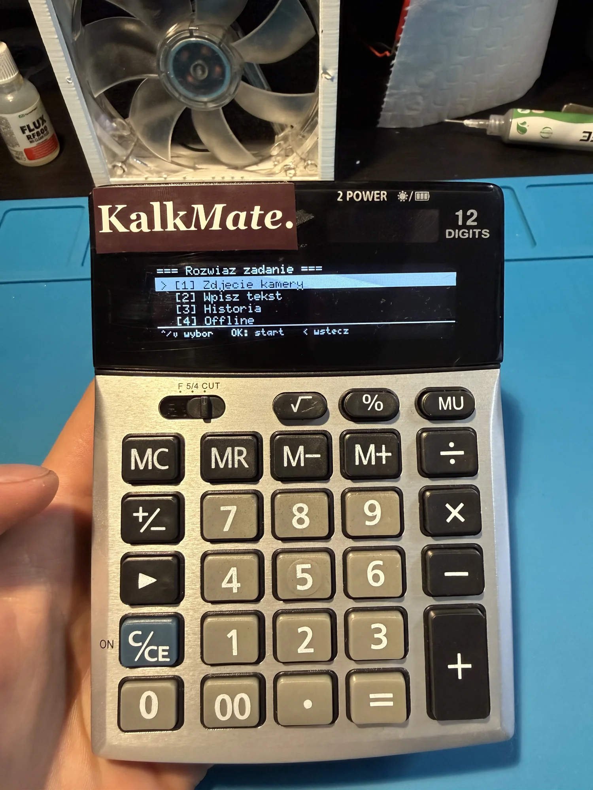
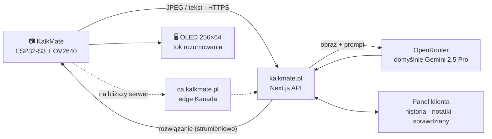
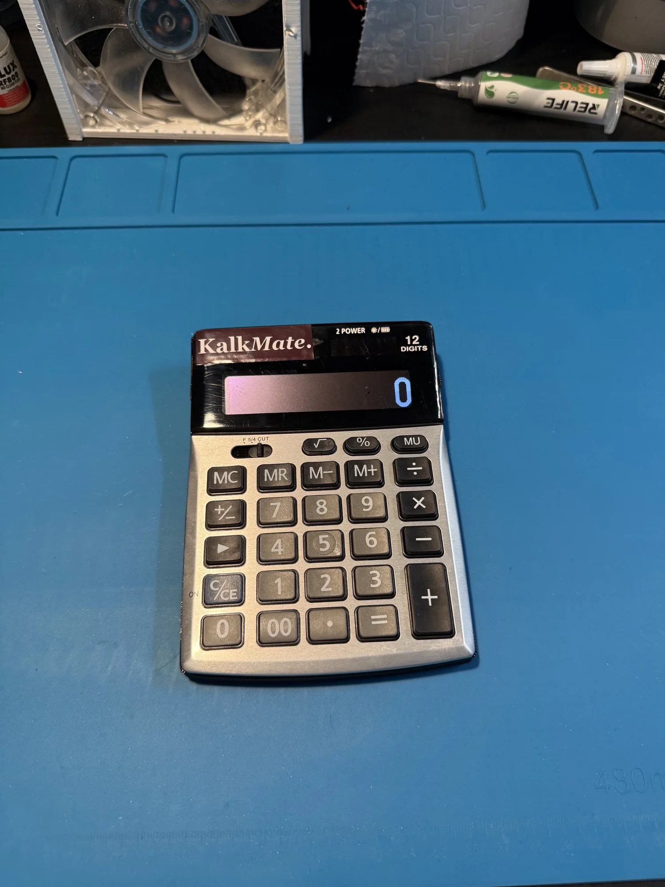
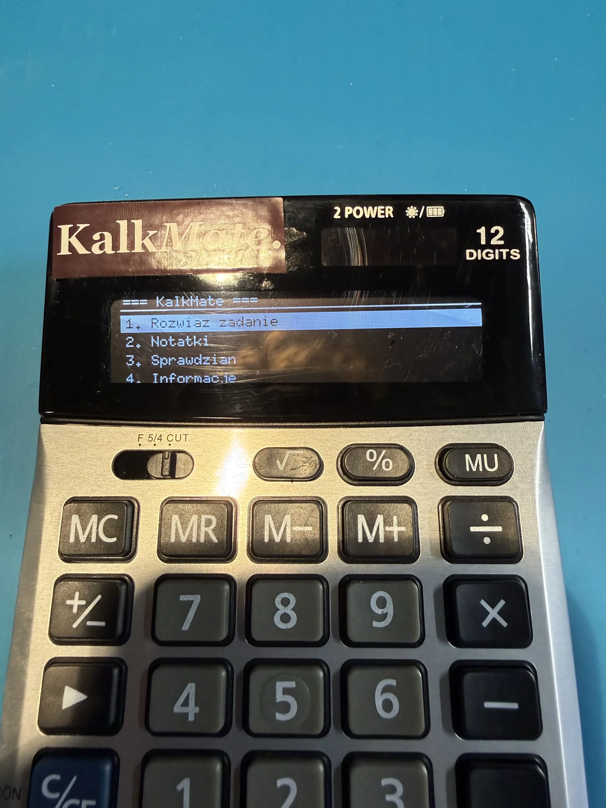
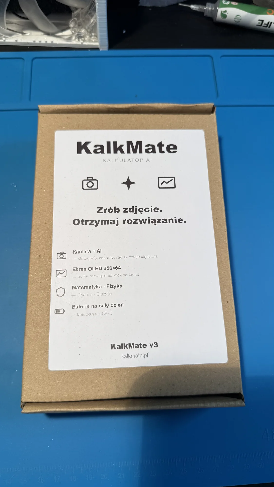
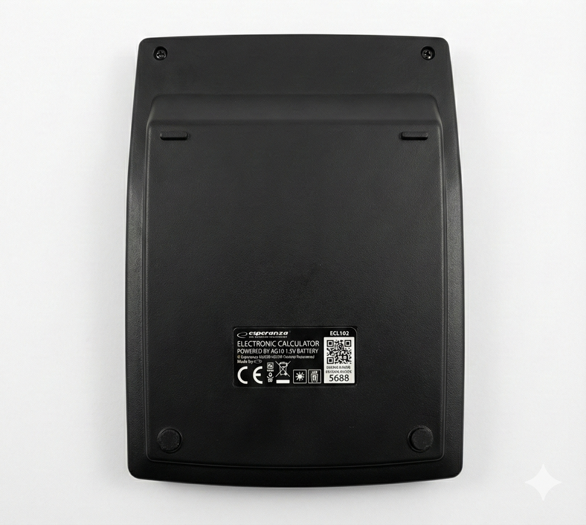

<p align="center">
  
</p>

<h3 align="center">Kalkulator z kamerą i AI do nauki</h3>

<p align="center">
  Zrób zdjęcie zadania — rozwiązanie krok po kroku pojawia się na ekranie kalkulatora.<br>
  Bez telefonu, bez przeglądarki, bez rozpraszaczy.
</p>

<p align="center">
  <a href="https://kalkmate.pl"></a>
  
  
  
  
</p>

<p align="center">
  <b>Polski</b> · <a href="README.en.md">English</a>
</p>

<p align="center">
  
</p>

---

## W skrócie

- **Zdjęcie albo tekst → rozwiązanie.** Wbudowana kamera OV2640, pełny tok rozumowania na OLED 256×64 — także długie rozwiązania (do ~96 KB tekstu, szybkie przewijanie po przytrzymaniu strzałki).
- **Matematyka, fizyka, chemia, biologia** — tryb „Egzamin” oparty na arkuszach CKE i zasadach oceniania, tryb „Czysty AI” do wszystkiego innego albo **własny system prompt** ustawiany w panelu.
- **Bez internetu też coś zrobi** — proste zadania (równania, układy, procenty, pochodne) liczy lokalnie, resztę kolejkuje do wysłania.
- **Notatki i sprawdziany** synchronizowane z panelu klienta na kalkmate.pl.
- **12 języków interfejsu** (PL, EN, DE, CS, SK, LT, BE, ES, PT, FR, IT, KO); ekran pokazuje też grekę, cyrylicę, koreański Hangul i symbole matematyczne (≠ ≤ ≥ ≈ √ ∞).
- **Aktualizacje przez WiFi** — podpisane OTA (ECDSA P-256), kampanie aktualizacji z panelu admina.
- **Tryb AI chroniony kodem** ustawianym przez właściciela; awaryjny reset fabryczny przytrzymaniem C/CE.

> 699 zł / 169 EUR z 2 mln tokenów AI w zestawie, 2 lata gwarancji. Wysyłka do Paczkomatów InPost w Polsce i kurierem za granicę. Można też **wypożyczyć** na tydzień, miesiąc albo 2 miesiące ([kalkmate.pl/wypozyczenie](https://kalkmate.pl/wypozyczenie)).

## Jak to działa



1. Uczeń wybiera **Zdjęcie kamery** (podgląd na żywo z paskiem ostrości) albo **Wpisz tekst**.
2. Kamera wyłącza się **przed** włączeniem WiFi — zegar kamery zakłóca 2,4 GHz.
3. Kalkulator wybiera najbliższy serwer (Mediolan albo edge w Kanadzie) i wysyła zadanie. Uwierzytelnia się tokenem per urządzenie.
4. Backend wysyła zadanie przez **OpenRouter**. Domyślny model to Gemini 2.5 Pro; w panelu można wybrać inny (Claude, GPT, Grok, DeepSeek, Qwen…). Koszt jest rozliczany w tokenach; jedna odpowiedź może mieć do 18 tys. tokenów.
5. Długie odpowiedzi idą z keepalive (serwer podtrzymuje połączenie, aż model skończy), kalkulator zapisuje je kawałkami do PSRAM. Wzory LaTeX są zamieniane na czytelny tekst i symbole, odpowiedź trafia do historii.

## Galeria

<table>
<tr>
<td width="50%" align="center">
<br>
<sub>Gotowy egzemplarz</sub>
</td>
<td width="50%" align="center">
<br>
<sub>Menu trybu AI: zadania, notatki, sprawdziany</sub>
</td>
</tr>
<tr>
<td width="50%" align="center">
<br>
<sub>Opakowanie KalkMate v3</sub>
</td>
<td width="50%" align="center">
<br>
<sub>Kamera zintegrowana z tylną częścią obudowy</sub>
</td>
</tr>
</table>

Film promocyjny (34 s, z lektorem): [`marketing/promo-video/`](marketing/promo-video/).

## Repozytorium

| Katalog | Co tam jest |
|---|---|
| [`src/`](src/), [`include/`](include/) | Firmware ESP32-S3 (C++ / Arduino, PlatformIO) |
| [`website/`](website/) | Sklep, wypożyczenia, panel klienta, panel admina i API urządzeń (Next.js) — [README](website/README.md) |
| [`fiscal-agent/`](fiscal-agent/) | Agent fiskalny (Python): paragony z platformy na drukarce POSNET po TCP/WiFi — [fiskalizacja](docs/fiskalizacja/README.md) |
| [`tools/flasher/`](tools/flasher/) | Programator produkcyjny (GUI + CLI): firmware, Flash Encryption, kod AI i język klienta, etykiety Niimbot, checklista wysyłki |
| [`tools/kalkmate-admin-desktop/`](tools/kalkmate-admin-desktop/) | Panel admina jako aplikacja Windows (Electron): programator, cichy druk etykiet, wbudowany agent fiskalny |
| [`tools/edge/`](tools/edge/) | Konfiguracja edge'a nginx (ca.kalkmate.pl) |
| [`tools/i18n/`](tools/i18n/) | Generator tłumaczeń interfejsu firmware |
| `tools/i2c_scan`, `keymap_scan`, `greek_font_test` | Narzędzia do uruchamiania płytek i testów wyświetlacza |
| `tools/etykieta-produktowa/` | Etykieta produktu 100×150 mm ze znakami zgodności |
| [`certyfikacja/`](certyfikacja/) | BOM, certyfikaty komponentów, deklaracja zgodności CE |
| [`docs/`](docs/) | Instrukcje obsługi v4 w 11 językach (HTML + PDF), formularze reklamacji, audyt bezpieczeństwa, model obudowy |
| [`marketing/`](marketing/) | Film promocyjny i jego źródła |

## Sprzęt (płytka v4)

| | |
|---|---|
| **MCU** | ESP32-S3-WROOM-1-N16R8 (16 MB flash QIO, 8 MB PSRAM OPI), natywne USB-C (USB-CDC) |
| **Ekran** | OLED SSD1322 256×64, 4-wire SPI, zasilanie 12 V z boosta MT3608 (EN na GPIO47) |
| **Kamera** | OV2640, 8-bit parallel + SCCB, LDO 2,8 V / 1,3 V; PWDN i RESET przez MCP23017 |
| **Klawiatura** | Membrana kalkulatora: 10 ścieżek FFC, 27 klawiszy, skanowanie parami przez ekspander I2C MCP23017 |
| **Zasilanie** | LiPo 3,7 V 1500 mAh, ładowarka MCP73831, ochrona DW01A + FS8205A, wskaźnik naładowania MAX17048 (starsze egzemplarze: dzielnik ADC, wykrywany automatycznie) |
| **Zgodność** | Deklaracja CE (RED / RoHS / LVD); moduł radiowy z certyfikatem RED producenta |

Peryferia są wyłączane, gdy nie są potrzebne: boost OLED (~140 mA), kamera (~50 mA), WiFi (~80 mA, z trybem uśpienia radia).
Pełny pinout, sekwencje startu i pułapki sprzętowe: [`CLAUDE.md`](CLAUDE.md). Stare płytki v3 (ESP32-WROVER-E) nie są już wspierane.

## Firmware

```bash
pio run -e esp32s3 -t upload   # jedyne środowisko: płytka v4 (ESP32-S3)
pio device monitor -b 115200
```

> Przed każdym wydaniem podbij `FW_VERSION` w `src/main.cpp` — OTA porównuje wersje. Wydanie OTA: build → podpis (`sign_firmware.sh`) → wersja w env serwera → `releases.json`.

| Moduł | Zadanie |
|---|---|
| `main.cpp` | start, pętla główna, menu |
| `calculator.h`, `factory_reset.h` | tryb kalkulatora, wejście do trybu AI kodem, reset fabryczny (przytrzymanie C/CE 5 s albo Ustawienia) |
| `solve_screen.h`, `camera.h` | podgląd na żywo, zdjęcie, zapytanie do AI, odbiór długich odpowiedzi do PSRAM, wyświetlanie z fallbackiem fontów |
| `offline_solver.h`, `offline_queue.h` | rozwiązywanie bez sieci i kolejka zapytań do wysłania |
| `notes.h`, `tests.h`, `history.h` | notatki, sprawdziany, historia |
| `device_account.h`, `account_screen.h` | rejestracja urządzenia, parowanie z kontem, status licencji, Device ID + kod QR |
| `server_select.h` | wybór najbliższego serwera (Mediolan / Kanada) |
| `ota_update.h`, `kalkmate_certs.h` | podpisane OTA, weryfikacja certyfikatu TLS serwera |
| `remote_session.h` | „Zdalna pomoc” — podgląd ekranu dla wsparcia, tylko po świadomym włączeniu przez użytkownika |
| `event_log.h` | log ważnych zdarzeń (błędy, resety) wysyłany przy rejestracji |
| `wifi_settings.h`, `wifi_persist.h`, `settings_screen.h` | WiFi, ustawienia, język |
| `i18n_extra.h`, `kalk_translit.h`, `ui_kit.h` | tłumaczenia interfejsu, transliteracja, wspólne elementy UI |
| `battery.h`, `power.h`, `input.h`, `panic.h` | bateria i oszczędzanie energii, klawiatura, powrót do ekranu kalkulatora |

### Historia wersji

| Wersja | Najważniejsze zmiany |
|---|---|
| 0.1 – 0.6 | kalkulator + WiFi, OTA, tryb AI, notatki i sprawdziany, parowanie urządzenia, LaTeX |
| 1.0 | płytka v4 na ESP32-S3 z natywnym USB-C |
| 1.1 – 1.3 | bateria i brownout, strojenie kamery (ekspozycja, balans bieli, orientacja) |
| 1.4 | podpisane OTA (ECDSA P-256), autoryzacja pobierania firmware |
| 1.5 | podgląd na żywo z paskiem ostrości |
| 1.7 | rozwiązywanie offline, synchronizacja czasu, interfejs PL/EN/DE, awaryjny reset fabryczny |
| 1.8 | lepsze wzory w odpowiedziach (potęgi, indeksy, symbole) |
| 1.9 | zdalna pomoc, kod klienta wgrywany przy produkcji, token per urządzenie |
| 2.0 | log zdarzeń, wskaźnik MAX17048, język wgrywany przy produkcji, reset fabryczny odpina od konta; 2.0.7 — najbliższy serwer (Mediolan / Kanada) |
| 2.1 | 2.1.3 — uśpienie radia WiFi; 2.1.4–2.1.5 — odpowiedzi do 18 tys. tokenów, odbiór z keepalive; 2.1.6 — symbole matematyczne na ekranie; **2.1.7 — koreański (Hangul), aktualna** |

## Strona, sklep i panele (`website/`)

Next.js 16 (App Router), React 19, Prisma 6 + SQLite, Tailwind CSS 4. Własny VPS (Ubuntu, nginx w Dockerze, PM2) pod [kalkmate.pl](https://kalkmate.pl) i [api.kalkmate.pl](https://api.kalkmate.pl), plus edge w Kanadzie (`ca.kalkmate.pl`) dla zapytań `solve`. Wdrożenie: paczka → staging build → kopia bazy → zamiana katalogów → health check z automatycznym rollbackiem.

- **Sklep (11 języków):** koszyk z wysyłką do Paczkomatów InPost i za granicę, zakup bez konta, kupony, promocje, personalizacja (kod AI i język kalkulatora). Płatności przez **Przelewy24** (BLIK, przelew, karty) i **Stripe**.
- **Wypożyczenia:** plany 7 / 30 / 60 dni, płatność BLIK lub przelewem, kaucja 300 zł albo weryfikacja tożsamości (Didit) zamiast kaucji. Najem liczy się od odbioru paczki (status InPost), po terminie serwer sam odcina AI, przypomnienia mailowe przed końcem i po terminie.
- **Panel klienta:** historia rozwiązań, notatki i sprawdziany wysyłane na urządzenie, wybór modelu i trybu AI (w tym własny system prompt), saldo i zakup tokenów, program partnerski.
- **Panel admina** (2FA, konta moderatorów z dostępem do wybranych sekcji; także jako aplikacja desktopowa i PWA):
  - **zamówienia:** wyszukiwanie, akcje zbiorcze, nadanie przez Base Courier / InPost, etykiety wysyłkowe i produktowe, numery seryjne, dokumenty celne, paragony fiskalne;
  - **wypożyczenia:** przypisanie kalkulatora po Device ID (także skanerem), przedłużenia, zwroty, rozliczenie kaucji;
  - **sprzedaż i marketing:** poczta z odpowiedziami pisanymi przez AI, czat wsparcia dla odwiedzających, newsletter tłumaczony maszynowo, kupony, analityka źródeł, UTM i lejka;
  - **urządzenia:** licencje, urządzenia, zdjęcia zadań (wyszukiwanie po ID kalkulatora), zdalna pomoc, zużycie AI, kampanie aktualizacji firmware, magazyn;
  - **utrzymanie:** codzienne kopie bazy.
- **API urządzeń** (`/api/device/*`): rejestracja, status konta, `solve` (z keepalive dla długich odpowiedzi), notatki, sprawdziany, rozmowy, OTA.
- **Automaty (cron, co godzinę):** śledzenie przesyłek, start i przypomnienia wypożyczeń, przypomnienia o nieopłaconych zamówieniach, anulowanie porzuconych, prośby o opinie, kopie zapasowe.

Uruchomienie lokalne i zmienne środowiskowe: [`website/README.md`](website/README.md).

## Produkcja

- **Programator** (`tools/flasher/`, też w aplikacji KalkMate Admin → Narzędzia → Programator): wgrywa firmware, włącza Flash Encryption (`PROD_DEV` → `PROD_REL`), ustawia kod AI i język klienta, sprawdza start firmware i zapisuje każdą sztukę w `production_log.csv`.
- **Etykiety na Niimbot B1 Pro** (Bluetooth, 50×30 mm): po udanym flashu programator drukuje etykietę z ID kalkulatora jako kod kreskowy Code 128 (naklejana w środku), a panel admina drukuje etykietę na tył obudowy (CE, RoHS, producent, WEEE, SN), po 1 albo 5 sztuk z tym samym numerem.
- **Etykiety wysyłkowe i produktowe** drukowane po cichu na drukarce termicznej 100×150 mm z aplikacji desktopowej.

## Bezpieczeństwo

- OTA tylko podpisane (ECDSA P-256 + SHA-256). Wszystkie połączenia HTTPS weryfikują certyfikat serwera (wbudowany root CA, bez `setInsecure()`).
- Token per urządzenie zamiast jednego wspólnego klucza; endpointy urządzeń sprawdzają, czy urządzenie ma dostęp do danego zasobu (ochrona przed IDOR).
- Produkcyjne egzemplarze mają Flash Encryption w trybie Release, wypalany przez programator (`PROD_REL`); klucze nigdy nie trafiają do instalatora.
- Panel admina: sesje odwoływalne pojedynczo + TOTP, osobne TOTP dla moderatorów; limity zapytań na logowaniu i endpointach AI.

Audyt i lista napraw: [`docs/security/`](docs/security/).

## Licencja

Kod jest publiczny **wyłącznie do wglądu**. Wszelkie prawa zastrzeżone — kopiowanie, modyfikacja, użycie komercyjne i produkcja urządzeń na bazie projektu wymagają pisemnej zgody autora. Szczegóły: [`LICENSE`](LICENSE).

---

<p align="center">
  <b>KAJPA Kacper Popko</b> · <a href="https://kalkmate.pl">kalkmate.pl</a>
</p>
